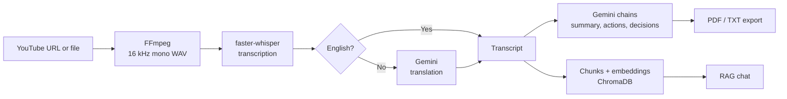

<div align="center">

# 🎙️ Minutely

### Turn any meeting recording into a summary, action items, decisions, and a chat you can ask questions to.

[Features](#-features) •
[How it works](#-how-it-works) •
[Quick start](#-quick-start) •
[Usage](#-usage) •
[Troubleshooting](#-troubleshooting) •
[Roadmap](#-roadmap)

</div>

---

## ✨ Features

| | Feature | Details |
|---|---|---|
| 🎥 | **Flexible input** | Paste a YouTube URL or upload MP3, WAV, M4A, MP4, MKV and more |
| 🗣️ | **Local transcription** | Runs [faster-whisper](https://github.com/SYSTRAN/faster-whisper) on your machine. No audio leaves your computer |
| 🌍 | **Multilingual** | Hindi, Urdu and other languages are translated to English with Gemini |
| 📝 | **Smart summaries** | Map-reduce summarization that handles long meetings |
| ✅ | **Action items** | Structured output: task, owner, deadline |
| 🧭 | **Key decisions** | Only decisions that were actually finalized |
| 💬 | **Chat with the meeting** | RAG with ChromaDB, history-aware questions, timestamped sources |
| 📄 | **Export** | PDF and TXT, including Hindi text support |

---

## 🧠 How it works



<details>
<summary><b>📚 Click to see the tech stack</b></summary>

| Layer | Tools |
|---|---|
| UI | Streamlit |
| Audio | yt-dlp, FFmpeg, PyAV |
| Speech-to-text | faster-whisper (runs locally) |
| LLM | Google Gemini via the AI Studio API |
| Orchestration | LangChain (LCEL), Pydantic structured output |
| Embeddings | HuggingFace sentence-transformers (local) |
| Vector store | ChromaDB (in memory, one collection per meeting) |
| Export | fpdf2 + uharfbuzz (Devanagari shaping) |

</details>

<details>
<summary><b>📁 Click to see the project structure</b></summary>

```
├── app.py                  # Streamlit UI
├── utils/
│   ├── audio.py            # yt-dlp download, FFmpeg conversion
│   ├── transcribe.py       # Whisper transcription
│   ├── chains.py           # Translation, summary, action items, decisions
│   ├── rag.py              # Chunking, ChromaDB, history-aware chat
│   └── export.py           # PDF and TXT export
├── fonts/                  # Optional: NotoSansDevanagari-Regular.ttf
├── .streamlit/config.toml  # Upload size limit
├── requirements.txt
├── .env.example
└── README.md
```

</details>

---

## 🚀 Quick start

### Prerequisites

- [ ] Python 3.10 or newer
- [ ] [FFmpeg](https://ffmpeg.org/download.html) installed and on your PATH (`ffmpeg -version` should work)
- [ ] A free Google AI Studio API key from [aistudio.google.com](https://aistudio.google.com)

### 1. Clone and install

```bash
git clone https://github.com/YOUR_USERNAME/YOUR_REPO.git
cd YOUR_REPO

python -m venv .venv
```

<details>
<summary><b>🪟 Windows</b></summary>

```powershell
.venv\Scripts\activate
pip install -r requirements.txt
```

</details>

<details>
<summary><b>🍎 macOS / 🐧 Linux</b></summary>

```bash
source .venv/bin/activate
pip install -r requirements.txt
```

</details>

### 2. Add your API key

Copy `.env.example` to `.env` and fill it in:

```env
GOOGLE_API_KEY=your_key_here
GEMINI_MODEL=gemini-2.5-flash
EMBED_MODEL=sentence-transformers/all-MiniLM-L6-v2
```

> ⚠️ Never commit `.env`. It is already listed in `.gitignore`.
>
> Free-tier model names change over time. If you get a 404 model error, check the current model name in AI Studio and update `GEMINI_MODEL`.

### 3. Run

```bash
streamlit run app.py
```

Your browser opens at `http://localhost:8501`.

---

## 🖱️ Usage

1. Pick **YouTube URL** or **Upload file** in the sidebar.
2. Choose the spoken language (or leave it on auto-detect) and a Whisper model size.
3. Optionally add **names and terms** (people, product names) to improve spelling.
4. Click **Process meeting** and watch the progress steps.
5. Explore the tabs: **Summary**, **Action items & decisions**, **Chat**, **Transcript**, **Export**.

<details>
<summary><b>⚙️ Which Whisper model should I pick?</b></summary>

| Model | Speed on CPU | Accuracy | Use it for |
|---|---|---|---|
| `tiny` | Fastest | Low | Testing the pipeline |
| `base` | Fast | Fair | Quick English tests |
| `small` | Moderate | Good | Default. Minimum for Hindi and Urdu |
| `medium` | Slow | Better | Urdu and noisy audio, ideally on a GPU |

On an older CPU, `small` can take roughly as long as the recording itself. A GPU is dramatically faster. To use one, change `device="cpu"` to `device="cuda"` in `utils/transcribe.py`.

</details>

<details>
<summary><b>💬 Example chat questions</b></summary>

- "Who is responsible for the login bug?"
- "When is that due?" (follow-up questions work, thanks to query rewriting)
- "What was decided about the launch date?"
- "Summarize what Rahul said."

Each answer shows its **Sources** with timestamps, so you can jump to the right moment in the recording.

</details>

<details>
<summary><b>🌍 Notes on Hindi and Urdu</b></summary>

- Whisper can confuse Hindi and Urdu because the spoken languages are very similar. Use the language dropdown to force the right one.
- Whisper sometimes mishears English words inside Urdu or Hindi speech. Adding names and terms helps, and `medium` is noticeably better than `small`.
- In the PDF, only the English transcript is included. The original-language transcript is available as a separate TXT download.

</details>

---

## 🛠️ Troubleshooting

<details>
<summary><b>❌ <code>open() got an unexpected keyword argument 'metadata_errors'</code></b></summary>

Your `av` package is out of date or mismatched with faster-whisper:

```bash
pip install -U av faster-whisper
```

</details>

<details>
<summary><b>🐢 The first run is very slow or looks frozen</b></summary>

- The first run downloads the Whisper model (roughly 150 to 500 MB) and the embedding model (about 90 MB).
- The first import of `sentence-transformers` can take a few minutes on Windows because antivirus scans the large libraries. Adding your `.venv` folder to the Windows Defender exclusions helps.
- Transcription is the slowest stage. A high CPU reading during it is normal.

</details>

<details>
<summary><b>🔤 Hindi shows as empty boxes in the PDF</b></summary>

Add a Devanagari font:

1. Download **Noto Sans Devanagari** from Google Fonts.
2. Put `NotoSansDevanagari-Regular.ttf` (the static version, not the variable one) in the `fonts/` folder.
3. Make sure `uharfbuzz` is installed: `pip install uharfbuzz`.

</details>

<details>
<summary><b>🎬 FFmpeg not found</b></summary>

Install FFmpeg and make sure `ffmpeg -version` works in a new terminal. On Windows, add the `bin` folder to your PATH and restart the terminal.

</details>

<details>
<summary><b>⏳ Gemini rate limit or quota errors (429)</b></summary>

The free tier has limits. The app retries automatically with backoff. If it keeps failing, wait a minute or check your quota in AI Studio.

</details>

<details>
<summary><b>📺 YouTube download fails</b></summary>

Update yt-dlp, since YouTube changes often:

```bash
pip install -U yt-dlp
```

If a video needs a login, export your browser cookies to a file **outside the repo** and point to it in `.env` as `YT_COOKIES`. Never commit a cookies file.

</details>

---

## 🔒 Privacy

- Transcription and embeddings run **locally**.
- Only text (the transcript and your questions) is sent to the Gemini API.
- Nothing is saved to disk by default. Results live in memory for the current session.

---

## 🗺️ Roadmap

- [x] YouTube and file upload
- [x] Local Whisper transcription
- [x] Hindi and Urdu to English translation
- [x] Summary, action items, decisions
- [x] RAG chat with timestamped sources
- [x] PDF and TXT export
- [ ] Save and reload past meetings
- [ ] Live transcription progress bar
- [ ] Speaker identification
- [ ] Docker image and one-click deployment

---

## 🤝 Contributing

Issues and pull requests are welcome. Please do not include API keys, cookies, or recordings in any commit.

---

<div align="center">

Built with ❤️ using Python, Whisper, LangChain, and Gemini.

</div>
